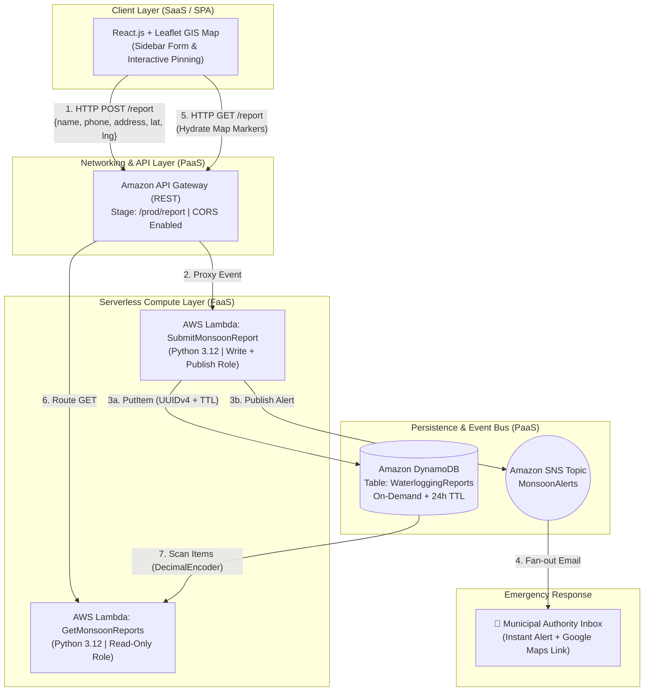

# 🌧️ MonsoonLens — Serverless Urban Waterlogging Detection & Alerting System


**MonsoonLens** is a cloud-native, event-driven crowdsourced hazard reporting platform designed to detect localized urban waterlogging and blocked stormwater drains in real time. Built on a **100% serverless AWS architecture**, the system allows citizens to pin flooded streets from a safe distance on an interactive GIS map, persists spatial telemetry in **Amazon DynamoDB** with automated **Time-To-Live (TTL)** lifecycle management, and dispatches instant municipal alerts via **Amazon SNS** with one-tap Google Maps navigation links.

> **Research & Regional Context:** Inspired by MIT’s [RiskMap India](https://riskmap.mit.edu/) flood-reporting pilot in Chennai, MonsoonLens is calibrated and field-tested across the **Chennai – Maraimalai Nagar – SRM – Mahindra World City (GST Road)** corridor.

---

## 📌 Table of Contents
1. [Problem Statement & Why Cloud Matters](#-problem-statement--why-cloud-matters)
2. [Key Architectural Features](#-key-architectural-features)
3. [System Architecture & Data Flow](#-system-architecture--data-flow)
4. [Cloud Service Selection (SaaS / PaaS / FaaS)](#-cloud-service-selection-saas--paas--faas)
5. [Database Schema & Automated TTL Lifecycle](#-database-schema--automated-ttl-lifecycle)
6. [Security & IAM Least-Privilege Design](#-security--iam-least-privilege-design)
7. [Performance, Scalability & Cost Evaluation](#-performance-scalability--cost-evaluation)
8. [Local Installation & AWS Deployment](#-local-installation--aws-deployment)
9. [Project Structure](#-project-structure)
10. [Author](#-author)

---

## 🚨 Problem Statement & Why Cloud Matters

### The Urban Bottleneck
During intense monsoon downpours, urban roads flood rapidly when heavy rainfall coincides with obstructed stormwater drains. Citizen distress reports are typically scattered across social media, helpline phone calls, and local messaging groups—resulting in delayed municipal response and uncoordinated inspection routing.

### Why Serverless Cloud Architecture is Mandatory
Emergency flood-reporting systems exhibit an extreme **99% Idle vs. 1% Spike** traffic pattern:
* **Sunny Days (Idle State):** Near-zero traffic during dry months. Traditional IaaS virtual machines (`EC2` + `RDS`) waste capital running $24/7$ while waiting for rain.
* **Monsoon Storms (Burst State):** Sudden, massive concurrent write spikes as thousands of citizens report flooded streets simultaneously.
* **The MonsoonLens Solution:** By leveraging **AWS Lambda**, **Amazon API Gateway**, **DynamoDB (On-Demand)**, and **Amazon SNS**, MonsoonLens operates at **$\$0.00$ idle cost** while scaling instantaneously from $0$ to $1,000+$ concurrent executions without manual provisioning or connection-pool exhaustion.

---

## ✨ Key Architectural Features

* **📍 Safe-Distance Interactive GIS Pinning:** Built with `React-Leaflet` (`useMapEvents`), allowing residents to click the exact flooded street coordinate on an OpenStreetMap canvas from a safe indoor location rather than standing in deep water.
* **⚡ Decoupled Read/Write Serverless Microservices:** Separates report ingestion (`SubmitMonsoonReport`) from spatial querying (`GetMonsoonReports`) for independent scaling, isolated error handling, and granular security permissions.
* **🔔 Real-Time Pub/Sub Municipal Alerting:** Integrates **Amazon SNS** (`MonsoonAlerts`) to fan out immediate email dispatches containing reporter metadata, timestamps, and clickable Google Maps deep-links to emergency field crews.
* **⏳ Automated 24-Hour Data Lifecycle (DynamoDB TTL):** Stamps every incoming report with a Unix epoch expiration timestamp (`ExpirationTime = current_time + 86,400s`). DynamoDB automatically purges resolved/stale reports after $24\text{ hours}$ at **zero compute cost**.
* **📊 CloudWatch Observability:** Tracks real-time Lambda `Invocations`, `Duration`, `ConcurrentExecutions`, and `Throttles` via a dedicated telemetry dashboard.

---

## 🏗️ System Architecture & Data Flow



---

## ☁️ Cloud Service Selection (SaaS / PaaS / FaaS)

| Architecture Layer | Cloud Model | Technology / Service | Technical Justification |
| :--- | :--- | :--- | :--- |
| **Client Presentation** | **SaaS / SPA** | **React.js (Vite) + Leaflet.js** | Renders lightweight OpenStreetMap tiles in the browser and captures floating-point `lat/lng` coordinates without paid mapping API quotas. |
| **API & Networking** | **PaaS** | **Amazon API Gateway (REST)** | Acts as the managed HTTPS front door (`/prod/report`), handling CORS preflight (`OPTIONS`) validation and request routing. |
| **Serverless Compute** | **FaaS / PaaS** | **AWS Lambda (Python 3.x)** | Executes stateless backend logic via `boto3`. Scales automatically per incoming request with sub-second cold/warm execution times. |
| **NoSQL Database** | **PaaS** | **Amazon DynamoDB** | High-velocity key-value storage in **On-Demand** mode; eliminates relational connection pooling bottlenecks during storm surges. |
| **Event Messaging** | **PaaS (Pub/Sub)** | **Amazon SNS** | Decouples emergency alert delivery from database writes; supports multi-subscriber fan-out (Email, SMS, Webhook). |
| **Monitoring** | **PaaS** | **Amazon CloudWatch** | Captures execution logs, latency metrics, and concurrency telemetry without external monitoring agents. |

---

## 🗄️ Database Schema & Automated TTL Lifecycle

* **Table Name:** `WaterloggingReports`
* **Region:** `ap-southeast-2` (AWS Sydney)
* **Capacity Mode:** `On-demand` (Pay-per-request)
* **Time-To-Live (TTL) Attribute:** `ExpirationTime` (Enabled — $24\text{-hour}$ automatic record expiration)

| Attribute Name | Key Type | Data Type | Sample Value | Description |
| :--- | :--- | :--- | :--- | :--- |
| `ReportID` | **Partition Key (PK)** | `String` | `15dcf550-b4c7-4549...` | Collision-free `UUIDv4` unique incident identifier |
| `ReporterName` | Attribute | `String` | `Hitesh` / `Tanmay` | Citizen name submitted via the sidebar form |
| `Phone` | Attribute | `String` | `8055181811` | Contact number for municipal verification |
| `Address` | Attribute | `String` | `Abode Valley` / `SRM` | Street landmark or neighborhood description |
| `Latitude` | Attribute | `String` | `12.734414` | Geolocation latitude captured from map click |
| `Longitude` | Attribute | `String` | `80.009908` | Geolocation longitude captured from map click |
| `Timestamp` | Attribute | `String` | `2026-10-28T21:07:03Z` | ISO-8601 UTC ingestion timestamp |
| `ExpirationTime` | **TTL Trigger** | `Number` | `1793308023` | Unix epoch timestamp ($+86,400\text{ s}$) for auto-deletion |

---

## 🔐 Security & IAM Least-Privilege Design

1. **Isolated IAM Execution Roles:**
   * **`SubmitMonsoonReport` Role:** Scoped strictly to DynamoDB write operations (`PutItem`) and `AmazonSNSFullAccess` to publish alerts to the `MonsoonAlerts` topic.
   * **`GetMonsoonReports` Role:** Restricted strictly to `AmazonDynamoDBReadOnlyAccess`. Even if the public `GET` endpoint is queried repeatedly, the function cannot modify, overwrite, or delete incident data.
2. **Cross-Origin Resource Sharing (CORS):**
   * Configured at both the **API Gateway** level (`Default 4XX`, `Default 5XX`, `OPTIONS`, `GET`, `POST`) and within the **Lambda proxy response headers** (`Access-Control-Allow-Origin: *`), ensuring secure browser communication.

---

## 📈 Performance, Scalability & Cost Evaluation

### Empirical CloudWatch Telemetry
* **Warm Invocation Latency:** $\approx 235\text{ ms}$
* **End-to-End Write + SNS Dispatch Duration:** $494.82\text{ ms}$
* **Throttled Requests (`Throttles`):** $0$ ($100\%$ packet delivery across concurrent test bursts)
* **DynamoDB Storage Efficiency:** Average item size of **$113.24\text{ bytes}$** ($1.9\text{ KB}$ for $17\text{–}19$ active records); `Scan` operations achieve **$100\%$ efficiency** consuming only **$2\text{ RCUs}$**.

### Cost Comparison: Serverless vs. Traditional IaaS

| Metric | Traditional IaaS (`t3.small` EC2 + RDS MySQL) | MonsoonLens Serverless (Lambda + DynamoDB + SNS) | Engineering Advantage |
| :--- | :--- | :--- | :--- |
| **Dry-Season Idle Cost** | $\approx \$32.00 / \text{month}$ ($24/7$ uptime) | **$\$0.00 / \text{month}$** | $100\%$ cost elimination during non-monsoon months. |
| **Monsoon Burst (50,000 Reports)** | High risk of CPU throttling / DB connection crash | **$\$0.00$** (Covered by AWS Free Tier) | $1\text{M}$ free Lambda requests & $25\text{ GB}$ free DynamoDB storage/month. |
| **Stale Data Cleanup** | Requires dedicated cron job / worker server | **$\$0.00$** (Native DynamoDB TTL) | Background garbage collection at zero compute cost. |
| **Operational Overhead** | OS patching, VPC sizing, connection pooling | **Fully Managed (Zero Ops)** | Focuses purely on emergency response logic. |

---

## 🚀 Local Installation & AWS Deployment

### Prerequisites
* **Node.js** ($\ge \text{v18.x}$) & **npm**
* **AWS Account** (Free Tier compatible)

### 1. Clone & Run the Frontend Locally
```bash
# Clone the repository
git clone https://github.com/Hitesh-09/monsoonlens.git
cd monsoonlens

# Install dependencies (React, Leaflet, React-Leaflet, Axios)
npm install

# Start the Vite development server
npm run dev
```
Open `http://localhost:5173` in your browser to interact with the live GIS interface.

### 2. AWS Serverless Backend Configuration
1. **DynamoDB:** Create a table named `WaterloggingReports` with Partition Key `ReportID` (`String`), set capacity to **On-demand**, and enable **TTL** on attribute `ExpirationTime`.
2. **Amazon SNS:** Create a Standard topic named `MonsoonAlerts` and confirm an **Email** subscription for municipal alerts.
3. **AWS Lambda:**
   * Deploy `SubmitMonsoonReport` (Python 3.12) with `AmazonDynamoDBFullAccess` and `AmazonSNSFullAccess` policies, setting `SNS_TOPIC_ARN` to your topic ARN.
   * Deploy `GetMonsoonReports` (Python 3.12) with `AmazonDynamoDBReadOnlyAccess`.
4. **Amazon API Gateway:** Create a REST API (`MonsoonLensAPI`), add a `/report` resource with `POST` and `GET` methods linked to the respective Lambdas, enable **CORS**, and deploy to the `prod` stage.

---

## 📂 Project Structure

```text
monsoonlens/
├── public/
├── src/
│   ├── App.jsx          # Main Split-Pane GIS Interface, Form State & Axios API Client
│   ├── main.jsx         # React DOM Entry Point & Leaflet CSS Injection
│   └── index.css        # Full-Viewport Reset & Layout Styling
├── aws-lambda/          # Reference Serverless Backend Microservices
│   ├── submit_report.py # POST Handler: UUIDv4 + DynamoDB PutItem + 24h TTL + SNS Publish
│   └── get_reports.py   # GET Handler: DynamoDB Scan + DecimalEncoder Serialization
├── package.json
├── vite.config.js
└── README.md
```

---

## 👨‍💻 Author

**Hitesh Shimpi**  
*GitHub:* [@Hitesh-09](https://github.com/Hitesh-09)  
*Project Context:* Cloud Computing (FT-III Case Study Evaluation — Serverless Event-Driven Architecture)
